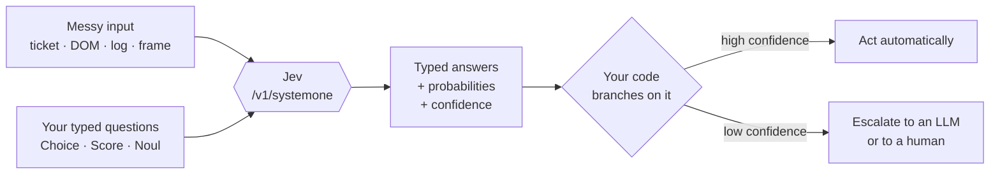

<div align="center">

# Awesome Jev 
**A curated list of noteworthy [Jev](https://docs.typesafe.ai/introduction) libraries, tools and resources.**

*Jev is [TypeSafe AI](https://typesafe.ai)'s **System One** model. It doesn't write text — it answers typed questions about your data and hands your code a value it can branch on.*

[What is Jev?](#what-is-jev) · [60-second quickstart](#60-second-quickstart) · [SDKs](#sdks--clients) · [Applications](#applications) · [Cookbooks](#cookbooks) · [Contribute](#contribute)

</div>

---

> **New here?** Start with [What is Jev?](#what-is-jev) — it assumes zero prior knowledge. If you already know Jev, jump to [SDKs & Clients](#sdks--clients).

Jev launched in early access on **15 September 2026**. This list is unofficial and not affiliated with TypeSafe AI. The ecosystem is young and moving fast — [pull requests welcome](#contribute).

## Contents

- [What is Jev?](#what-is-jev)
  - [The one-sentence version](#the-one-sentence-version)
  - [How it fits in your app](#how-it-fits-in-your-app)
  - [The three question types](#the-three-question-types)
  - [Jev vs. a normal LLM](#jev-vs-a-normal-llm)
  - [When to use it — and when not to](#when-to-use-it--and-when-not-to)
  - [Confidence, and why it matters](#confidence-and-why-it-matters)
  - [Pricing, latency and limits](#pricing-latency-and-limits)
- [60-second quickstart](#60-second-quickstart)
- [Official](#official)
- [Community](#community)
- [SDKs & Clients](#sdks--clients)
- [Applications](#applications)
- [Demos & Games](#demos--games)
- [Agent Tools](#agent-tools)
- [Research & Open Models](#research--open-models)
- [Cookbooks](#cookbooks)
- [Patterns](#patterns)
- [Articles](#articles)
- [Glossary](#glossary)
- [Related lists](#related-lists)
- [Contribute](#contribute)
- [License](#license)

---

## What is Jev?

### The one-sentence version

**Jev is a smart `if` statement.**

You hand it a blob of messy real-world data (a support ticket, a DOM tree, a log line, a game board) plus a list of *typed questions*. It hands back one answer per question — a probability, a category from a list you defined, or a rating on a scale you defined — in ~100 ms, for a fraction of a cent.

It cannot write you a paragraph. That is the point.

```
# Not this:                              # But this:
llm("Is this urgent? Reply YES/NO")      jev(state=ticket, questions={
  -> "Yes, this appears urgent!"             "urgent": Noul("Is this urgent?")
  -> now parse the string...               })
  -> hope it didn't say "Certainly!"        -> {"urgent": 0.93}
                                            -> if answer.noul > 0.8: page_oncall()
```

TypeSafe calls this a **System One model**, after [Kahneman's System 1 / System 2](https://docs.typesafe.ai/concepts/system-one): fast, intuitive judgment, as opposed to slow deliberate reasoning. Jev is the reflex. Your code — and, where you want it, an LLM — is the deliberation.

It is named after the economist [William Stanley Jevons](https://en.wikipedia.org/wiki/William_Stanley_Jevons).

### How it fits in your app

An LLM is usually the product. Jev is a component *inside* an ordinary product — dropped in exactly where your code needs one judgment it can't express as a regex.



Three properties follow from the design, and they're the whole pitch:

1. **It cannot hallucinate a value.** The answer is constrained to the options you supplied. If your categories are `bug`, `billing` and `other`, there is no fourth category it can invent. Structured-output error rate is **0%** by construction, not by prompt engineering.
2. **It answers every question in one parallel pass.** Ten questions cost roughly one request, not ten. (See [speculative fan-out](#patterns).)
3. **Its probabilities are calibrated.** It was trained with RLCD — *Reinforcement Learning for Calibrated Decisions* — which optimises for honest probabilities rather than for human preference the way RLHF does. When Jev says 0.7, it's meant to be right about 70% of the time.

### The three question types

Everything Jev does is built from three primitives. You compose them in code.

| Primitive | You ask | You get back | Use it for |
| --- | --- | --- | --- |
| [**Noul**](https://docs.typesafe.ai/primitives/noul) | "Is this statement true?" | `noul` — a probability 0–1 | Flags, filters, guardrails, yes/no gates |
| [**Choice**](https://docs.typesafe.ai/primitives/choice) | "Pick one of these options" | `choice`, `probabilities`, `confidence` | Routing, classification, picking an action |
| [**Score**](https://docs.typesafe.ai/primitives/score) | "Rate this on my scale" | `score`, `probabilities`, `confidence` | Severity, quality, ranking, prioritisation |

<details>
<summary><b>What each one actually returns</b> (click to expand)</summary>

**Noul** — the yes/no atom. Just a probability.

```json
{ "type": "noul", "noul": 0.93 }
```

**Choice** — the winner, the full distribution, and how peaked that distribution is.

```json
{
  "type": "choice",
  "choice": "billing",
  "probabilities": { "billing": 0.91, "technical": 0.07, "other": 0.02 },
  "confidence": 0.94
}
```

**Score** — a probability-weighted mean over the levels *you* described, plus the raw distribution.

```json
{
  "type": "score",
  "score": 2.4,
  "legend": ["Cosmetic", "Degraded with workaround", "Blocking"],
  "probabilities": [0.05, 0.50, 0.45],
  "confidence": 0.71
}
```

Note that `score` is continuous. A 2.4 means it's genuinely torn between "degraded" and "blocking" — information a plain label would have thrown away.

</details>

Questions in a single request all run **in parallel against the same state**. They don't see each other's answers. That independence is why batching is nearly free — and why you should ask atomic questions and combine them yourself, rather than asking one giant compound question.

### Jev vs. a normal LLM

| | **Jev (System One)** | **Frontier LLM (System Two)** |
| --- | --- | --- |
| Output | Typed values constrained to your schema | Free-form text you have to parse |
| Sampling | Parallel, one pass | Sequential, token by token |
| Latency | **70–500 ms** (typically ~100 ms) | 3–30 s |
| Cost | **$0.042 / M input tokens**, output free | Input *and* output billed, output ~5× |
| Hallucination | Structurally impossible | Ever-present |
| Confidence | Calibrated probabilities | Usually overconfident prose |
| Can it write? | **No** | Yes |
| Can it reason multi-hop? | Weakly | Yes |

On TypeSafe's own four-workflow benchmark Jev scored **67.8%**, against **67.9%** for GPT-5.6 Terra — while being, at the high end of the range, **~194× faster and ~445× cheaper**. Treat vendor benchmarks as vendor benchmarks; the [Research & Open Models](#research--open-models) section below collects independent evals, including ones where Jev *loses*.

They are not really competitors. The common production shape is **both**: Jev triages every request cheaply, and only the hard or low-confidence slice ever reaches an LLM.

### When to use it — and when not to

**Reach for Jev when:**

- You're making the same judgment thousands or millions of times (classify, route, score, flag, rank).
- The answer set is closed and known in advance.
- Latency matters — realtime loops, per-keystroke, per-frame, per-request middleware.
- You want a number you can threshold, not prose you have to parse.
- You're currently paying an LLM to do a job a good classifier would do.

**Do not reach for Jev when:**

| It struggles with | Why | Do this instead |
| --- | --- | --- |
| Math & counting | It judges, it doesn't compute | Count in code, ask Jev about the result |
| Dates & time logic | Dates are just text to it | [Extract named parts](https://docs.typesafe.ai/cookbooks/date_extraction_cookbook), resolve in code |
| Writing anything | It emits no strings at all | Hand off to an LLM |
| Images, audio, video | Text-only input today | Pre-transcribe / OCR / describe |
| Double negatives, multi-hop | Accuracy degrades | Split into atomic questions |
| More than 255 options | Hard cardinality cap | [Hierarchical Choice](https://docs.typesafe.ai/cookbooks/hierarchical_classification) |

The rule of thumb from the docs: **numbers, dates and counting stay in code.** *You pick a card from the deck — you don't ask Jev to name a card.*

Known failure modes for the current public model are documented honestly at [Jev 1.13 jaggedness](https://docs.typesafe.ai/model-jaggedness/jev-1.13).

### Confidence, and why it matters

Every `Choice` and `Score` comes with a `confidence` in 0–1, derived from how peaked the probability distribution is. **The answer tells you *what*; the confidence tells you *whether to act*.**

A widely used gating policy — tune the thresholds on your own labelled data:

```python
if confidence > 0.9:      act()                   # non-destructive, automatic
elif confidence > 0.5:    act_with_confirmation()
else:                     escalate()              # to an LLM, or to a human
```

This is the single most important pattern in the ecosystem. See [confidence-gated routing](https://docs.typesafe.ai/patterns/confidence-routing), and [jevcal](https://github.com/abhixhek/jevcal) for fitting thresholds empirically.

### Pricing, latency and limits

| | |
| --- | --- |
| **Input** | $0.042 per million tokens |
| **Output** | Free |
| **Latency** | 70–500 ms end to end |
| **Endpoint** | `POST https://api.typesafe.ai/v1/systemone` |
| **Models** | `jev-latest`, `jev-preview`, pinned e.g. `jev-1.13.0` |
| **Rate limits** | ~250,000 tokens/s, ~1,200 req/min (early access) |
| **Max Choice options** | 255 |
| **Input modality** | Text only |

Responses report the exact model version that answered — pin it if you've tuned thresholds against it.

**Getting access:** the [TypeSafe waitlist](https://typesafe.ai) gates the direct API. To skip it, Jev is also hosted on [Vercel AI Gateway](https://vercel.com/ai-gateway/models/jev) as `typesafe-ai/jev` and on [Cloudflare Workers AI](https://developers.cloudflare.com/ai/models/typesafe/jev/).

## 60-second quickstart

<details open>
<summary><b>Python</b></summary>

```bash
pip install typesafe-sdk          # Python 3.10+
export TYPESAFE_API_KEY=sk-...
```

```python
from typesafe_sdk import Choice, Noul, Score, TypeSafeClient

client = TypeSafeClient()

response = client.system_one(
    state="Export button crashes in Safari. I've been charged twice already this month.",
    questions={
        "urgent": Noul(
            instructions="Does this message express urgency?"
        ),
        "department": Choice(
            instructions="Which team should handle this?",
            criteria={
                "billing": "Charges, refunds, invoices",
                "technical": "Bugs and broken functionality",
                "other": "Anything else",
            },
        ),
        "severity": Score(
            instructions="How severe is the reported problem?",
            criteria=[
                "Cosmetic issue",
                "Degraded feature with a workaround",
                "Blocking issue with no workaround",
            ],
        ),
    },
)

a = response.answers
print(a["urgent"].noul)          # 0.93
print(a["department"].choice)    # "billing"
print(a["severity"].score)       # 2.4

if a["department"].confidence > 0.9:
    route_to(a["department"].choice)
else:
    escalate_to_human()
```

All three questions above are answered in **one** request, in parallel.

</details>

<details>
<summary><b>JavaScript / TypeScript</b></summary>

```bash
npm install @typesafe-ai/sdk
export TYPESAFE_API_KEY=sk-...
```

```ts
import { choice, noul, score, TypeSafeClient } from '@typesafe-ai/sdk'

const client = new TypeSafeClient()

const { answers } = await client.systemOne({
  state: { ticket: 'Export button crashes in Safari' },
  questions: {
    category: choice('What type of ticket is this?', {
      bug_report: 'Something is broken',
      feature_request: 'New functionality is being asked for',
    }),
    severity: score('How severe is it?', [
      'Cosmetic issue',
      'Degraded feature with a workaround',
      'Blocking issue',
    ]),
  },
})

if (answers.category.confidence > 0.9) route(answers.category.choice)
```

</details>

<details>
<summary><b>Vercel AI SDK (no waitlist)</b></summary>

```ts
import { experimental_evaluate as evaluate } from 'ai'
import { typeSafeAi } from '@ai-sdk/typesafe-ai'

const result = await evaluate({
  model: typeSafeAi.evaluationModel('jev-latest'),   // or gateway id 'typesafe-ai/jev'
  state: { message: 'Charged twice, please refund' },
  questions: {
    department: {
      type: 'choice',
      criteria: { billing: 'Payments', support: 'Everything else' },
    },
  },
})
```

</details>

<details>
<summary><b>Raw HTTP</b></summary>

```bash
curl https://api.typesafe.ai/v1/systemone \
  -H "Authorization: Bearer $TYPESAFE_API_KEY" \
  -H "Content-Type: application/json" \
  -d '{
    "model": "jev-latest",
    "state": { "ticket": "Charged twice for order A-104" },
    "questions": {
      "department": {
        "type": "choice",
        "instructions": "Which team handles this?",
        "criteria": {
          "billing": "Charges and refunds",
          "technical": "Technical problems"
        }
      }
    }
  }'
```

</details>

No key yet? Try the [Playground](https://console.typesafe.ai/playground) in the browser, or the free no-signup [Yes / No demo](https://yesno.coderai.dev).

---

## Official

- [TypeSafe](https://typesafe.ai) - Company homepage, waitlist, and product overview.
- [Documentation](https://docs.typesafe.ai/introduction) - Introduction, primitives, patterns, API, and SDKs. Start with the [quick start](https://docs.typesafe.ai/introduction/quickstart).
- [Playground](https://console.typesafe.ai/playground) - Paste a state, add questions, see typed answers in the browser.
- [API keys](https://console.typesafe.ai/settings/keys) - Dashboard for TypeSafe API keys (`TYPESAFE_API_KEY`).
- [HTTP API](https://docs.typesafe.ai/api) - `POST https://api.typesafe.ai/v1/systemone`.
- [Workflow evals](https://evals.typesafe.ai) - Published eval methodology and per-model results.
- [GitHub org](https://github.com/typesafe-ai) - Official open-source repositories.
- [Agent skill](https://docs.typesafe.ai/agent-skill) - Drop-in skill for Claude Code, Codex, and other coding agents ([`typesafe-ai/skills`](https://github.com/typesafe-ai/skills)).
- [Jev 1.13 jaggedness](https://docs.typesafe.ai/model-jaggedness/jev-1.13) - Known failure modes of the current public model.
- [Introducing System One Models and Jev](https://typesafe.ai/blog/introducing-system-one-models-and-jev) - Launch post: architecture, RLCD, pricing, the Doom and Wikiracing demos, FAQ.
- [Jev on Vercel AI Gateway](https://vercel.com/ai-gateway/models/jev) - Hosted `typesafe-ai/jev` for AI SDK `evaluate`, no TypeSafe waitlist required.
- [Jev on Cloudflare Workers AI](https://developers.cloudflare.com/ai/models/typesafe/jev/) - Another hosted route into the model.
- [Manifesto](https://typesafe.ai/manifesto) - The case for machine-native intelligence built for software, not conversation.
- [The Bitterest Lesson](https://typesafe.ai/blog/bitterest-lesson) - Why optimizing the wrong task can dominate gains from scale.
- [AI: too good to be true, too bad to be useful](https://typesafe.ai/blog/ai-too-good-to-be-true-too-bad-to-be-useful-typesafe-ai) - Argument against preference-optimized chat models for automation.

## Community

- [Discord](https://discord.gg/typesafe) - Official TypeSafe server. Builder demos live in [Show and Tell](https://discord.com/channels/1483217544214085663/1483217545040232493).
- [X @typesafeai](https://x.com/typesafeai) - Product and research updates.
- [LinkedIn](https://www.linkedin.com/company/typesafe-ai/) - Company announcements and hiring.

## SDKs & Clients

Official first, then community clients. Community packages are not affiliated with TypeSafe unless noted.

**Official**

- [Python SDK](https://github.com/typesafe-ai/typesafe-sdk-python) - `pip install typesafe-sdk`. Docs: [Python SDK](https://docs.typesafe.ai/sdk/python).
- [JavaScript / TypeScript SDK](https://github.com/typesafe-ai/typesafe-sdk-js) - `npm install @typesafe-ai/sdk`. Docs: [JavaScript SDK](https://docs.typesafe.ai/sdk/javascript).
- [System One adapter (Python)](https://github.com/typesafe-ai/system-one-adapter-python) - Drop-in `TypeSafeClient` replacement backed by LLM APIs, for comparing Jev against chat models on the same questions. `pip install system-one-adapter`.
- [Vercel AI SDK provider](https://ai-sdk.dev/providers/ai-sdk-providers/typesafe-ai) - `@ai-sdk/typesafe-ai` plus `experimental_evaluate`. Use `typeSafeAi.evaluationModel('jev-latest')` or the Gateway id `typesafe-ai/jev`.

**Community**

- [Elixir SDK](https://github.com/nshkrdotcom/typesafe_sdk) - Hex package [`typesafe_sdk`](https://hex.pm/packages/typesafe_sdk) for `system_one` and model listing. Docs: [HexDocs](https://hexdocs.pm/typesafe_sdk).
- [Jev (Elixir OTP)](https://github.com/dannote/jev) - Hex package [`jev`](https://hex.pm/packages/jev): Jev as a peer GenServer; answers arrive as messages you pattern-match, with network-free tests.
- [Ruby SDK](https://github.com/joshmn/typesafe-sdk) - Ruby 3.1+ client: Noul / Choice / Score, retries, model listing, thread-safe pooled HTTP. No async client.
- [RubyLLM TypeSafe](https://github.com/kieranklaassen/ruby_llm-typesafe) - TypeSafe provider for RubyLLM 2 with offline model metadata and typed responses.
- [typesafe-ai-rails](https://github.com/GenieRobot/typesafe-ai-rails) - Rails integration on top of the official Python SDK: config, usage/cost telemetry, opt-in confidence policies.
- [Rust SDK (typesafe-ai-rs)](https://github.com/gilljon/typesafe-ai-rs) - Independent async and blocking client for System One.
- [TypeSafe AI for Rust](https://github.com/Twister915/typesafe-ai) - Another Rust client: async + blocking transports, typed responses, observable retries.
- [typesafe-rs](https://github.com/AbdelStark/typesafe-rs) - Latency-focused Rust transport SDK aiming for behavioral parity with the official clients.
- [s1-rs](https://github.com/AbdelStark/s1-rs) - Rust derive layer for Choice / Score / Noul, typed question sets, confidence gates, and network-free tests.
- [Advocaat](https://github.com/pithings/advocaat) - Small TypeScript client with tagged helpers for chances, choices, and scores.
- [Scala / ZIO SDK](https://github.com/jamesward/zio-typesafe-ai) - ZIO client with a small DSL for noul / choice / score.
- [.NET SDK](https://github.com/saibimajdi/typesafe-dotnet-sdk) - Client for typed questions and confidence-scored answers.
- [PHP SDK](https://github.com/Butochnikov/typesafe-sdk-php) - Typed DTOs, promises, and exceptions. Used by the Laravel package below.
- [Laravel TypeSafe Jev](https://github.com/Butochnikov/laravel-typesafe-jev) - Laravel 12/13 integration: config, facade, scoped DI, and a recording fake on the PHP SDK.
- [jev-go](https://github.com/Gaurav-Gosain/jev-go) - Go client for typed judgments and calibrated probabilities. `go get github.com/Gaurav-Gosain/jev-go`.
- [Stumble/jev-go](https://github.com/Stumble/jev-go) - Dependency-free Go SDK for TypeSafe direct and Vercel AI Gateway, with typed questions, retries, an interactive CLI, and an installable agent skill.
- [jevclient](https://github.com/AboveColin/jevclient) - Async Python client (`pip install jevclient`). Typed Noul / Choice / Score helpers, separate from the official `typesafe-sdk`.
- [LlamaIndex Jev](https://github.com/WiktorB2004/llama-index-jev) - LlamaIndex reranker (`JevRerank`) and router (`JevSingleSelector` / `JevMultiSelector`) on the official Python SDK.
- [Swift SDK](https://github.com/ainame/swift-typesafe) - Swift 6.4 client aligned with the Python SDK 0.6.0 API, including Linux.
- [TypeSafe AI Swift SDK](https://github.com/alterhq/typesafe-sdk-swift) - Dependency-free Swift 6 client for Choice / Score / Noul, with strict concurrency, configurable authentication and retries, and network-free tests.

## Applications

Open-source products and demos that put Jev in a real loop.

**Browser & computer agents**

- [Jev Ultrafast](https://github.com/browser-use/jev-ultrafast) - Browser agent from [Browser Use](https://github.com/browser-use). Jev picks an operation and a DOM element in one request; a small LLM writes text only for `TYPE_TEXT`. Zürich → London on Google Flights in ~7s. Library, local inspector, and measurements included.
- [JevBrowserExt](https://github.com/chy4pro/JevBrowserExt) - Chrome extension (Manifest V3) port of Jev Ultrafast: Jev picks the operation and DOM element in one request, a small text model writes typed values, and it runs in the user's own tabs through OpenRouter, TypeSafe or Cloudflare. Includes a 17-task headless-Chromium suite with recorded traces.
- [Jev for Chrome](https://github.com/chy4pro/jev-for-chrome) - Sibling Chrome extension port of Jev Ultrafast with the same one-request operation + element selection.
- [jev-ego](https://github.com/romaluev/jev-ego) - Browser agent on [ego lite](https://lite.ego.app/): one TypeSafe request picks operation + indexed element; agent-facing observe/act/suggest/step CLI.
- [jev-browser](https://github.com/Ying-Kai-Liao/jev-browser) - Browser automation: an LLM plans the outcome, Jev decides each click/type on a Playwright snapshot (~300 ms/call). Ships as a library, CLI, and MCP server (`npx -y -p jev-browser jev-browser-mcp`).
- [Jev Browser (Vlad Terin)](https://github.com/vlad-terin/jev-browser) - Agent skill + runtime: Codex plans, Jev selects elements, a runner acts and verifies each step.
- [typesafe-computer-use](https://github.com/awlevin/typesafe-computer-use) - macOS computer-use loop: OCR the screen, Jev classifies the next action, then click. About $0.0002/step.
- [Mobile Jev](https://github.com/droidrun/mobile-jev) - Android agent on [Mobilerun](https://mobilerun.ai): Jev decides each tap. Opens Uber, SFO → Golden Gate, payment screen in ~21s / 9 actions. Live studio, CLI, and traces. No ADB.
- [Yappy](https://yappy.biz/jev/) - macOS voice agent (closed source, public write-up with measurements). Jev picks the operation and target control from the window's accessibility table each step; a chat model writes text only for typing, and the full agent takes over when confidence drops. Author-reported: 275–690 ms per decision, $0.003 for five.

**Search, code & data**

- [Every](https://github.com/sufianetaouil/every) - Semantic code-search CLI: a yes/no question against every function, ranked by Noul probability.
- [blink](https://github.com/ellipsis-dev/blink) - Codebase search: an ensemble of walkers asks Jev which file answers a natural-language query.
- [Jev Search](https://github.com/superagents-lab/jev-search) - Web search app using Jev's Choice and Noul judgments to select sources, time ranges, and query candidates, then rank results retrieved through Search1API.
- [neo4jev](https://github.com/jexp/neo4jev) - Neo4j graph navigation: at each node Jev chooses which relationship to follow, with beam search over log-probabilities.
- [sqlite3-jev](https://github.com/mattn/sqlite3-jev) - SQLite C extension: `jev_noul` / `jev_choice` / `jev_score` as SQL functions via libcurl.
- [jevql](https://github.com/kylemclaren/jevql) - psql-shaped CLI and Go/TypeScript/Python SDKs for vanilla Postgres: `jev()` / `jev_prob` / `jev_choice` / `jev_score` in plain SQL with no extension. The SQL runs on the server and Jev judges the surviving rows in batches.
- [jev-tree](https://github.com/reachjalil/jev-tree) - Recursive Choice over a taxonomy so catalogs larger than Jev's 255-option cap still fit.
- [jev-align (Sutro)](https://github.com/sutro-sh/jev-align) - Active-learning CLI that evaluates CSV, Parquet, and JSONL rows with Jev, asks people to label uncertain and audit samples, and uses GEPA to propose improved definitions.
- [jev.nvim](https://github.com/valentynkit/jev.nvim) - Neovim plugin that splits the buffer into functions with Treesitter, scores each against a plain-language question with Jev, and ranks answers by probability in the quickfix window.
- [jev-shell-history](https://github.com/mrnugget/jev-shell-history) - Fish-style zsh autosuggestions: Jev ranks recent history as you type.

**Infrastructure, guardrails & code quality**

- [hono-jev-router](https://github.com/yusukebe/hono-jev-router) - Experimental Hono router: Jev matches an incoming request to a plain-language route description.
- [jev-resilience](https://github.com/Vicente-MD/jev-resilience) - Spring WebFlux starter: a semantic circuit breaker that uses Jev to catch silent HTTP 200 failures.
- [tripwire](https://github.com/noelzappy/tripwire) - AI SDK middleware and OpenAI-compatible proxy: seven Jev checks on every LLM response in ~100 ms, confidence-gated.
- [ProgressGate](https://github.com/AshutoshVJTI/progressgate) - Detects semantic stagnation in agent loops: Jev judges the trajectory; code returns CONTINUE / WARN / REPLAN / HALT.
- [jev-harness](https://github.com/AntonioCoppe/jev-harness) - Production layer around Jev: policy, confidence gate, shadow mode, recipes, and an eval CLI.
- [Supercov](https://github.com/supercorp-ai/supercov) - Code quality and test coverage for coding agents: Jev scores each source file so the agent knows what to fix first.
- [Jev Review](https://github.com/devagrawal09/jev-review) - Staged code-review workflow and local dashboard driven by focused Jev calls.
- [Foreman](https://github.com/thruwire/foreman) - Software-factory loop: Codex implements; Jev independently judges completeness, tests, and whether a human is needed.
- [jev-secret-detection](https://github.com/teyhouse/jev-secret-detection) - Secret-in-diff detector with repeatable Jev verdicts.
- [commit-miner](https://github.com/devanshbatham/commit-miner) - Rust CLI that classifies commit diffs with Jev: bug fixes, security/CWEs, and change types. HTML/CSV reports.
- [Jev Logs](https://github.com/reachjalil/jevlogs) - OpenTelemetry log triage: Jev scores diagnostic value and priority before an expensive LLM looks at the archive.
- [jev-eval-agent](https://github.com/vinilana/jev-eval-agent) - Public eval harness for early Jev tests.
- [jev-codex-router](https://github.com/0xNatoshi/jev-codex-router) - Per-turn Codex routing: Jev picks model, thinking depth, and speed mode.
- [jev-router](https://github.com/gargpratyush/jev-router) - Per-turn routing for Claude Code and Codex: Jev sends simple work to the fast tier and hard work to the strong tier. `npm i -g jev-router`.

**Consumer & everything else**

- [Unclutter](https://github.com/kitze/unclutter) - Chrome / Firefox extension: Jev classifies nonessential page elements; local template rules hide them on later visits.
- [TypeSafe AdBlock](https://github.com/realZachi/typesafe-adblock) - Chrome extension: Jev judges whether a DOM element is an ad and removes it. BYOK, no backend. The author calls it a demo, not a real ad blocker.
- [jev-skip](https://github.com/valentynkit/jev-skip) - Browser extension that reads the YouTube caption track and paints a per-segment sponsor probability on the seek bar before the intro ends, with no crowd database — reported to catch 77% of SponsorBlock's sponsor seconds across 23 videos at $0.0008 a video.
- [HA-Jev](https://github.com/AboveColin/HA-Jev) - Home Assistant integration: typed questions about entity state become sensors and automation actions, with a target picker that builds the state from the user's own entities, plus usage, cost, and daily-budget entities.
- [Jev Web Analyzer](https://github.com/replynodes/jev-web-analyzer) - Analyzes a public SaaS landing page as clean Markdown and asks Jev ten bounded `Choice` questions about first-visit understanding, including the first change to make.
- [Human Compiler](https://github.com/asfarsadewa/human-compiler) - Paste corporate prose; Jev scores passive-aggression, urgency, and information density, then code emits rustc-style diagnostics. Live: [human-compiler.asfarlab.fun](https://human-compiler.asfarlab.fun).
- [JEVMETER](https://github.com/ChetasLua/jevmeter) - Live Jev meter on any video: every sentence scored, rendered as a 16:9 edit.
- [jev-audio-beeper](https://github.com/santos-sanz/jev-audio-beeper) - Low-latency audio insult detector: Jev decides, ffmpeg beeps in ~466 ms without rewriting the rest of the track.
- [Jev Drone](https://github.com/RomanSlack/jev-drone) - MuJoCo quadrotor: control and safety stay in code; Jev handles slower tactical judgments.
- [jev-askable-arm](https://github.com/TarunTomar122/jev-askable-arm) - Zero-shot English goals on a simulated Franka. Jev chains hardcoded primitives.
- [Jev Trade](https://github.com/aowang-ai/jev-trade) - Live Hyperliquid desk: each tick Jev answers Choice questions for long/short, open/close/hold, and leverage; code places or pulls the quote. Dry-run by default. Demo: [jev-trade.com](https://www.jev-trade.com/).
- [Jev Trader](https://github.com/jarrodwatts/jev-trader) - One buy/sell decision per Monad block on Kuru's MON-USDC book. Live demo: [jev-trader.vercel.app](https://jev-trader.vercel.app/).
- [Smart home assistant demo](https://docs.typesafe.ai/demos/smart-home) - Official interactive demo of [speculative fan-out](https://docs.typesafe.ai/patterns/fan-out): many questions in one call, code keeps the relevant answers, LLM only for splits and chit-chat.

## Demos & Games

Toys, live sites, and realtime agents. Most shipped in the first 48 hours after launch.

- [Yes / No](https://yesno.coderai.dev) - Free no-signup Noul demo. Ask a question, get yes / no / maybe, with web search when needed. **Best first click if you've never seen Jev.**
- [TypeSafe Typewriter](https://typesafe-demo.val.run/) - Live Val Town demo: 16 typed judgments update as you type.
- [Jev Tetris](https://jev-omega.vercel.app) - Jev picks rotation and column from holes, stack height, and bumpiness.
- [Jev Pac-Man](https://jev-pacman.ephraimduncan.com) - Maze as JSON; Jev picks the turn at each junction in realtime.
- [typesafe-mario](https://github.com/fhshaik/typesafe-mario) - Super Mario Bros. from structured emulator state.
- [jev-doom-agent](https://github.com/lukaske/jev-doom-agent) - Browser-native Doom with Chocolate Doom WASM, spatial state, and live decision telemetry.
- [jev-plays-pokemon-red](https://github.com/valentynkit/jev-plays-pokemon-red) - Pokemon Red on PyBoy where deterministic code owns the route and arithmetic and Jev picks only at branches, with every battle turn's faint prediction scored by Brier against the emulator's RAM state.
- [Jev Plays StarCraft](https://github.com/phyous/tsai-sc) - Structured-state harness for the original StarCraft shareware campaign, with verified run and probability traces.
- [Jev × Civilization II](https://github.com/phyous/tsai-civ2) - Original Civ II in a browser; Jev chooses empire, city, research, and unit actions. Experimental; no verified win yet.
- [jev-gomoku](https://github.com/mizchi/jev-gomoku) - MoonBit client plus Jev-vs-Jev gomoku; write-up: [jev 同士に五目並べで対戦させた](https://zenn.dev/mizchi/articles/jev-plays-gomoku).
- [jev-t-rex-runner](https://github.com/joshlarsen/jev-t-rex-runner) - Chrome dinosaur game played by Jev.
- [snake-jev](https://github.com/siroccomask/snake-jev) - Snake: hundreds of typed direction decisions per run.
- [sudoku-vs-jev](https://github.com/zebedelu/sudoku-vs-jev) - Terminal Sudoku where Python owns the rules and Jev picks one move per turn — steady while forced moves exist, shaky once it has to guess.
- [JevsBistro](https://github.com/andrewsilber/JevsBistro) - Deterministic 3D restaurant sim that replays the same dinner service to compare rule-based, camera-assisted, and Jev-planned waiters, logging each decision's state, options, confidence, and latency.
- [Little Airways](https://github.com/lbotinelly/jev-little-airways) - Toy archipelago ATC: Jev judges divert / emergency / who lands first from each plane's local state, ~150 ms.
- [Hollow Creek](https://hollow-creek-sigma.vercel.app) - Village NPCs that *judge* you each tick (what to do, how they feel) instead of chatting.
- [got-jev](https://github.com/phureewat29/got-jev) - Game of Thrones roleplay as Jon Snow. A story model writes the scene; Jev answers where he is, how much danger, and what should play under it.
- [jev-canvas](https://github.com/gaborishka/jev-canvas) - Draw on a tldraw canvas with your voice and a webcam-tracked finger; Jev decides action, target and place on every partial transcript. English and Ukrainian commands.
- [Jev Guard](https://guard-jev.vercel.app) - Comment-moderation playground.
- [Jev mood demo](https://jev-demo.vercel.app) - Talk nicely or nastily over time; structured state tracks mood.
- [Jev Room](https://jev-room.moe136231.chatgpt.site) - One sentence → six room settings. Jev chooses, the app renders.

## Agent Tools

Tools that expose Jev to coding agents and MCP clients.

- [TypeSafe agent skill](https://github.com/typesafe-ai/skills) - **Official.** Primitives, patterns, and how to structure evaluations. Claude Code: `claude plugin marketplace add typesafe-ai/skills` then `claude plugin install typesafe@typesafe-ai`. Other agents: `npx skills add typesafe-ai/skills --skill typesafe-ai`.
- [eve](https://github.com/vercel/eve) - Vercel's agent framework. Experimental `autoModel` defaults to Gateway `typesafe-ai/jev` to pick a language model from an allowlist.
- [jev-mcp](https://github.com/jkudish/jev-mcp) - Node MCP wrapping three cookbook patterns: `jev_verify` (citation check), `jev_screen` (prompt-injection / guardrails), `jev_find` (semantic ranking without embeddings). `npx -y github:jkudish/jev-mcp`.
- [Jev MCP (Python)](https://github.com/blakestone-x/jev-mcp) - Python MCP server: classify, score, check, match, and screen tools.
- [Jev Review MCP](https://github.com/NiazMorshed2007/jev-review) - Local-first MCP: Claude Code, Codex, Cursor, and OpenCode get structured quality review from Jev while they write.
- [typesafe-mcp](https://github.com/itsmostafa/typesafe-mcp) - Go CLI and single-binary MCP for Claude Desktop, Claude Code, and Codex.
- [Jevbridge](https://github.com/gamesonrblx/Jevbridge) - ACP/MCP adapter: typed Jev decisions and computer use beside Codex, Claude, Grok, and OpenCode.
- [fast-jev-compaction](https://github.com/tamaratran/fast-jev-compaction) - Claude Code plugin and npm library: Jev scores tool calls and drops stale ones instead of summarizing context.
- [SkillRanker](https://github.com/Dicklesworthstone/skillranker) - Rust CLI: Jev ranks which agent skill fits the next step from live session context, with Claude Code hooks.
- [jev-axi](https://github.com/shiftynick/jev-axi) - CLI plus Claude Code and Codex hooks: Jev scores each shell command for hazards before it runs and screens fetched text for prompt injection, with routine commands decided locally so nothing is sent.
- [jev-belay](https://github.com/valentynkit/jev-belay) - Claude Code Stop hook that checks the transcript for evidence before trusting a "done" claim, spending one four-question Jev call only when files changed with no passing check since, and failing open on every error path.
- [jev-commit](https://github.com/valentynkit/jev-commit) - Pre-commit hook where one Jev call judges whether the commit message matches the staged diff, flags debug leftovers and unmentioned work, and blocks only when it detects a credential.
- [jev-pref](https://github.com/doeixd/jev-pref) - Turn AGENTS.md preferences into a Jev-powered AI linter: project-specific semantic review rules in `jev-pref.json`, checked against hunks, staged files, or PRs. `npx jev-pref setup`.
- [jev-use](https://github.com/shitianfang/jev-use) - Claude Code, Codex and pi plugin: Jev answers the batched typed questions an agent loop needs, with a typed escalation contract handing writing and low-confidence steps back to the LLM.
- [ask-jev-skill](https://github.com/shantanugoel/ask-jev-skill) - Hermes skill: ask Jev whenever the agent needs a bounded decision.
- [jev-system-architect](https://github.com/samtay32/jev-system-architect) - Skill that hunts for brittle semantic logic and turns it into Choice / Score / Noul boundaries.
- [augustus](https://github.com/24601/Augustus) - Design-judgment skill: maps Choice/Score/Noul onto classical methods (decision theory, rerank, routing) with a composition algebra, question-design diagnosis, and falsifying validation gates.
- [Bicameral](https://github.com/AbdelStark/bicameral) - Pi coding harness: LLM writes, Jev supplies typed reflexes for policy, loop detection, and review. Explicitly not a sandbox.
- [pi-typesafe](https://github.com/DevMortimer/pi-typesafe) - Pi extension: one consented, key-managed TypeSafe client, batched `typesafe_evaluate`, offline-testable transport.
- [pi-jev](https://github.com/y0usaf/pi-jev) - Pi extension with a shadow-mode tool-call gate, output judge, and typed `jev_ask`.
- [pi-warden](https://github.com/DevMortimer/pi-warden) - Pi guardrails on pi-typesafe: held tool results instead of a dialog; write checks against a project rules file.
- [pi-jev-auto-mode](https://github.com/jomatsu/pi-jev-auto-mode) - Pi auto mode: Jev semantically approves `bash` / `write` / `edit`, and fails closed when it cannot decide.

## Research & Open Models

Independent work inspired by Jev's interface, plus independent evaluations. **These are not TypeSafe models, and some of these benchmarks show Jev losing** — which is exactly why they're worth reading.

**Open reimplementations**

- [jevlike](https://github.com/vinnylarouge/jevlike) - Train a small one-pass scorer that maps context + N text options to a probability per option. Includes Doom / chess vision demos and a Wikispeedia next-click example. Explicitly *not* a reproduction of TypeSafe's architecture or RLCD.
- [openjev](https://github.com/TheoLeeCJ/openjev) - Can we run something Jev-like on a home RTX 3090? Reads option logits instead of generating text.
- [LitJev](https://github.com/zhengxuyu/litjev) - Turns any Qwen model into a fast decision model, serving the same `/v1/systemone` schema (Choice, Score, Noul) with no training and no generated answer text.
- [PlayJev](https://github.com/OmniJev/PlayJev) - Qwen3.5-0.8B-Base fine-tuned to play ten browser games from 448 px frames: one forward pass per move, a probability over the game's option list read off the option letters, no generated text. Open weights plus a browser demo.
- [decider](https://github.com/Mapika/decider) - Qwen3.5-2B fine-tune that emits typed decisions with calibrated probabilities in one pass.
- [PocketJev](https://github.com/NullPo-jp/PocketJev) - On-device iPhone visual decisions with MLX + Qwen3-VL option logits. Camera + 3-choice, no text generation, ~1s, no photo saved.
- [jev-visual](https://github.com/hr98w/jev-visual) - Educational Jev-like visual inference on Apple Silicon: shared multimodal context, candidate scoring, sorting-factory / Breakout / gesture demos.
- [jevmlx](https://github.com/bnsd55/jevmlx) - Jev-style parallel constrained decisions for any MLX model on Apple Silicon: schema-valid JSON in one forward pass.
- [JEVfire](https://github.com/kikoncuo/jevfire) - Jev-inspired parallel decisions for CUDA LLMs via vLLM, with a browser Mario demo (~71 ms/action locally).

**Independent evals & benchmarks**

- [ASSAY-001](https://github.com/jourdanlabs/assay-001) - Pre-registered check of Jev calibration and type safety on Banking77 / CLINC150. Split verdict, full logs. Write-up: [donttrustme.ai](https://donttrustme.ai/assay-001.html).
- [typesafe-ai-benchmark](https://github.com/iammrduncan/typesafe-ai-benchmark) - Side-by-side of Jev vs Qwen 3.8 27B on Cerebras for the same System One questions.
- [Jev Rerank Bench](https://github.com/anessbelbati/jev-rerank-bench) - Reranking comparison with raw provider responses, scoring code, uncertainty intervals, and documented limits.
- [Jev search rerank eval](https://github.com/zhuyansen/jev-search-rerank-eval) - 9,831 labelled pairs: Jev rerank vs BM25 / bge-m3, with judge-circularity measured. Fusion wins; **Jev alone does not beat embeddings**.
- [Jev Phishing Bench](https://github.com/anisselbd/jev-phishing-bench) - 2,000 emails: Jev vs Claude Haiku 4.5 on click-or-not, with calibration, latency, and cost. **Haiku wins accuracy here.**
- [Jev Spam Eval](https://github.com/bitnovus/jev-spam-eval) - Exploratory zero-shot spam study vs trained TF-IDF baselines, with post-hoc-tuning caveats.
- [jev-agent-failure-benchmark](https://github.com/TokenTrim/jev-agent-failure-benchmark) - Who&When Pro (injected agent failures): Jev vs a strong LLM on who / which step / error category.
- [jev-sec-bench](https://github.com/Gaurav-Gosain/jev-sec-bench) - Blind prompt-injection and vulnerable-code detection benches on public corpora, built on jev-go.
- [Smoking-history extraction benchmark](https://github.com/vclic/smoking-extraction-benchmark) - 1,000 synthetic notes: Jev vs OpenAI structured outputs on accuracy, cost, and latency.
- [Jev DSPy Lab](https://github.com/jmanhype/jev-dspy-lab) - DSPy companion that records and replays TypeSafe calls while measuring calibration, selective risk, confidence-gated abstention, latency, tokens, and modeled cost.
- [jevcal](https://github.com/abhixhek/jevcal) - CLI that fits a per-question confidence threshold to a target accuracy on your own labeled data, verifies it on a held-out split, shows how much traffic still needs an LLM fallback, and fails CI when a Jev update breaks the locked thresholds.

## Cookbooks

Official, copy-pasteable workflows. Full index: [console cookbooks](https://console.typesafe.ai/docs/cookbooks) and [docs index](https://docs.typesafe.ai/llms.txt).

- [Parallel questions](https://docs.typesafe.ai/cookbooks/parallel_questions) - Batch many questions over one state; one call instead of N. **Read this one first.**
- [Line-by-line search](https://docs.typesafe.ai/cookbooks/semantic_find) - Score hundreds of line ids against a query with Choice + a Noul "does an answer exist?" check.
- [Re-ranking](https://docs.typesafe.ai/cookbooks/rerank_typesafe) - BM25 shortlist, then one TypeSafe question per query–candidate pair.
- [Guardrails for LLMs](https://docs.typesafe.ai/cookbooks/llm_guardrails) - Screen messages in and out of an LLM; threshold probabilities in code.
- [Double-checking citations](https://docs.typesafe.ai/cookbooks/citation_check) - Choice over whether a quote's context supports the claim; confidence gates human review.
- [Classifying RAG passages](https://docs.typesafe.ai/cookbooks/classifying_rag_passages) - Keep, flag, or drop retrieved passages (contradiction, prompt injection) before the answering model.
- [Function calling](https://docs.typesafe.ai/cookbooks/function_calling) - Map natural-language requests onto ordinary typed functions with closed-set arguments.
- [Skill suggestion](https://docs.typesafe.ai/cookbooks/skill_suggestion) - Rank an agent skill catalog, then read only the top few.
- [Hierarchical classification](https://docs.typesafe.ai/cookbooks/hierarchical_classification) - Beam search over deep taxonomies with Choice probabilities. The escape hatch from the 255-option cap.
- [SDE cascade](https://docs.typesafe.ai/cookbooks/sde_cascade) - Two-stage structured-data-extraction cascade (mini → verify → reasoning).
- [Date extraction](https://docs.typesafe.ai/cookbooks/date_extraction_cookbook) - Ask for named date parts, resolve and validate in code.
- [Pre-parsed value extraction](https://docs.typesafe.ai/cookbooks/pre_parsed_value_extraction_cookbook) - Regex candidates, then Jev selects the requested span.
- [Knowledge graph entity alignment](https://docs.typesafe.ai/cookbooks/entity_alignment) - Score merge / leave unlinked / send to a curator.
- [Autoresearch feature discovery](https://docs.typesafe.ai/cookbooks/autoresearch_feature_discovery) - Propose TypeSafe questions as numeric features for a supervised model.
- [Classification using confidence](https://docs.typesafe.ai/cookbooks/classification_using_confidence) - Report a fine label only when confidence is high; otherwise climb the hierarchy.
- [Structure recovery](https://docs.typesafe.ai/cookbooks/autoformat) - Reconstruct Markdown from de-formatted plain text.
- [Self-consistency: nouls](https://docs.typesafe.ai/cookbooks/consistency_noul_cookbook) / [choices](https://docs.typesafe.ai/cookbooks/consistency_choice_cookbook) - Route uncertain probabilities to review without hiding the raw values.

## Patterns

Architectural recipes from the docs. These four cover most production Jev code.

- [Speculative fan-out](https://docs.typesafe.ai/patterns/fan-out) - Ask many questions at once, including ones that may not apply, and filter in code. Batching 13 questions into one call measured ~12× cheaper and ~10× faster than 13 sequential calls.
- [Confidence-gated routing](https://docs.typesafe.ai/patterns/confidence-routing) - The answer is *what*; the confidence is *whether to act*.
- [Composite scoring](https://docs.typesafe.ai/patterns/composite-scoring) - Atomic scores from Jev, weights you own in code — visible, versioned, and editable without retraining anything.
- [Intent routing](https://docs.typesafe.ai/patterns/intent-routing) - Classify cheaply, then hand off to logic, a specialist LLM, or a human.

See also: [How to build with TypeSafe](https://docs.typesafe.ai/concepts/how-to-build-with-system-one), the [use-case map](https://docs.typesafe.ai/concepts/use-case-map), and [confidence](https://docs.typesafe.ai/confidence).

## Articles

Independent measurements, experiments, explainers, and news. Official posts live under [Official](#official).

**Explainers**

- [A deep dive into Jev, TypeSafe's System One model](https://flaviocopes.com/jev/) - Flavio Copes. Probably the best single long-form introduction.
- [Jev: TypeSafe's System One Model That Never Hallucinates](https://www.datacamp.com/blog/system-one-models-jev) - DataCamp. Benchmarks and comparison tables.
- [What Is Jev? A Guide to TypeSafe AI's System One Model](https://www.langchain.com/blog/building-a-harness-with-jev) - LangChain, on building a harness around Jev.
- [Jev: The Language Model That Won't Talk](https://anthonymaio.substack.com/p/jev-the-language-model-that-wont) - Anthony Maio.
- [Jev Explained: TypeSafe AI's Non-Autoregressive System-1 Model](https://www.mindstudio.ai/blog/jev-system-one-model-launch) - MindStudio.
- [How to Use Jev: a practical guide](https://dev.to/valyuai/how-to-use-jev-a-practical-guide-to-typesafes-system-one-model-g5e) - DEV Community.
- [Jev](https://nerdy.dev/jev) - Adam Argyle's notes.
- [Using TypeSafe's Jev for evals](https://langfuse.com/blog/2026-09-18-using-typesafes-jev-for-evals) - Langfuse, on Jev as an eval judge.
- [Jev TypeScript quickstart: build a typed ticket router](https://www.refix.ai/news/jev-quickstart-typescript/) - End-to-end TypeScript tutorial.

**Measurements & experiments**

- [Jev in the Wild](https://arxiv.org/abs/2609.30216) - Data-driven analysis of 2,170 public GitHub Jev projects, reporting early ecosystem growth, application domains, and decision-use patterns.
- [Testing Jev on public and private data: classifier or filter?](https://amankumar.ai/blogs/jev-measured) - 16,000 calls vs gpt-5.4-mini and gpt-5.6-luna; where it wins, where it breaks, and a threshold procedure.
- [Jev: one judge call, or twelve dimension scores? I measured both on three tasks](https://agentjournal.dev/blog/llm-judge-vs-feature-extraction/) - One direct Jev question per row against 12–14 Jev-scored dimensions with locally fitted weights, with token costs, confidence intervals, and false-positive rates.
- [Mini-Vibe Check: TypeSafe's Jev Judged Everything I've Written in 0.7 Seconds](https://every.to/also-true-for-humans/mini-vibe-check-typesafe-s-jev-judged-everything-i-ve-written-in-0-7-seconds) - Every's Mike Taylor runs Jev over a writing corpus.
- [TypeSafeのJevを正しく驚く、それってLLMでできませんか？](https://zenn.dev/nwn/articles/824026c76116e0) - Reproduces the JSON-vs-logit shortcut on Gemma and compares Jev with LLMs on the public Mario harness.
- [jev 同士に五目並べで対戦させた](https://zenn.dev/mizchi/articles/jev-plays-gomoku) - Jev vs Jev gomoku with source and timing logs.

**News**

- [TypeSafe AI debuts model for machines that plays Doom](https://www.theregister.com/ai-and-ml/2026/09/16/typesafe-ai-debuts-model-for-machines-that-plays-doom/5296711) - The Register.
- [TypeSafe AI Releases Jev: A System One Model That Returns Typed, Calibrated Decisions Instead of Text](https://www.marktechpost.com/2026/09/19/typesafe-ai-releases-jev/) - MarkTechPost.

## Glossary

| Term | Meaning |
| --- | --- |
| **System One model** | A model class built for fast, structured judgment rather than text generation — Kahneman's System 1. Jev is the first. |
| **State** | The data you're asking about. A string or JSON object — ticket text, DOM snapshot, game board, log line. |
| **Question** | A typed thing you want to know about the state. One of Noul, Choice or Score. |
| **Noul** | Yes/no primitive. Returns a probability 0–1. |
| **Choice** | Pick-one primitive over a closed option set (max 255). Returns the winner, the distribution, and confidence. |
| **Score** | Rating primitive over ordered levels you describe. Returns a continuous probability-weighted mean. |
| **Confidence** | How peaked the distribution is, 0–1. Your signal for whether to act automatically or escalate. |
| **Calibration** | Whether a stated probability matches real-world frequency. Jev is trained for it; most LLMs are not. |
| **RLCD** | Reinforcement Learning for Calibrated Decisions — TypeSafe's training method, in place of RLHF. |
| **Speculative fan-out** | Asking many questions in one call, including ones that may not apply, then filtering in code. |
| **Jaggedness** | TypeSafe's term for a model's documented, uneven failure modes. |

## Related lists

- [AnotiaWang/awesome-jev](https://github.com/AnotiaWang/awesome-jev) - The list much of this one's ecosystem index derives from. Also available in [简体中文](https://github.com/AnotiaWang/awesome-jev/blob/main/README_zh.md).
- [MrJev/awesome-jev](https://github.com/MrJev/awesome-jev) - Selective list behind a 10-star bar, with hands-on reviews at [mrjev.com](https://mrjev.com/best-jev-tools/) recording what each tool sends and where.
- [typesafe-ai on PyPI](https://pypi.org/project/typesafe-ai/) - Community redirect shim. The real package is `typesafe-sdk`; this name was registered to block slopsquatting. Not affiliated with TypeSafe.

## Contribute

Pull requests welcome — see [CONTRIBUTING.md](CONTRIBUTING.md) for the full guidelines. In short, to add a project:

1. One entry, one line: `- [Name](url) - What it does, in a sentence.`
2. Put it in the right section, roughly grouped with similar projects.
3. It must actually be built on Jev, or be clearly and explicitly inspired by its interface.
4. Say plainly whether it's official or unofficial. Don't imply a TypeSafe affiliation that doesn't exist.
5. Benchmarks and evals are welcome **including when Jev loses** — negative results are the most useful entries here.

Descriptions should say what a thing does, not how great it is. No marketing copy.

## Disclaimer

This is an unofficial, community-maintained list. It is not affiliated with, endorsed by, or sponsored by TypeSafe AI. Performance figures quoted here are reported by their respective sources — vendor claims are labelled as such, and the [Research & Open Models](#research--open-models) section collects independent checks. Verify anything load-bearing against [the official docs](https://docs.typesafe.ai/introduction) before you ship it.

## License

[CC0 1.0](LICENSE) — dedicated to the public domain.

Ecosystem entries are adapted from [AnotiaWang/awesome-jev](https://github.com/AnotiaWang/awesome-jev), also CC0.
